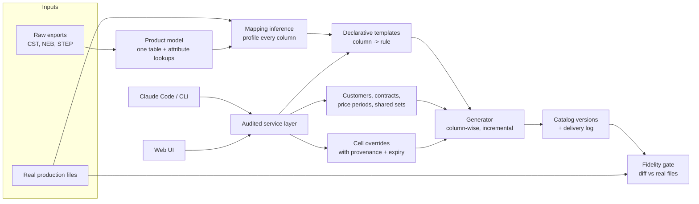

# Fresh-start design: the catalog system, rebuilt for efficiency

**Purpose:** if we rebuilt the Catalog Workshop from scratch with what the proof of concept (POC) taught us, how should it be designed to reach the same result (236 customer catalogs that match production exactly) with far less effort, and to run cheaply afterwards?
**Status:** proposal, 2026-10-02. Based on the POC in this repo (see `docs/audit-decisions.md`, `docs/business-user-playbook.md`).

## 1. What the POC cost, and where the effort went

| Fact | Effort impact |
|---|---|
| Templates were first built from 8 sample files, then re-audited against the full set of 236 real files | Most templates were written twice |
| Full-population comparison (the scoreboard) arrived about three weeks in | 13.3M wrong cells fixed by trial and error before that |
| 606 distinct Python expression strings across 3,575 columns | Hard to test or reuse, unsafe for business users, and duplicated logic (later folded into shared builtins) |
| Every column was hand-mapped, though most columns are constants, blanks or direct master fields | Repetitive mapping work |
| Current/Future modeled as separate sibling configs (236 configs, about 120 contracts) | Doubled edits, the "January 1" confusion, a one-sided consistency check |
| Any generator edit made every catalog stale; a full refresh took about 1 h on 8 GB | Dozens of hour-long verification cycles |
| Audit, history, exclusions and identity were added late | Gaps surfaced only in business-user tests |
| 30,604 cells had no source and were copied from real files | Snapshot built and wired in three different ways |

**Lesson:** most of the effort went into *discovering* what the real files contain. The fastest path is to make discovery automatic and do it first.

## 2. Design principles

1. **Data and measurement first.** Load every raw export and real file, and stand up the full-population comparison, before writing any template.
2. **Infer, then review.** Derive draft column mappings automatically from the real files, and have humans review only what inference can't explain.
3. **Declarative over code.** Templates are data (mappings plus named transforms), never eval'd strings.
4. **One audited service.** Every write (CLI, web, agent) goes through one library that records history.
5. **Incremental by default.** Rebuild and re-verify only what an edit can affect.
6. **Model the business, not the files.** One customer with contracts and price periods. Shared sets are named and referenced.

## 3. Architecture

### 3.1 Mapping inference (the biggest saving)
For each real file, profile every column across the full population and classify it automatically:
- **Constant or blank:** emit a constant. In the POC this covered most columns, all hand-written.
- **Equals a product-model field** (exact, or after a known transform from the library: tag stripping, symbol replacement, case, truncation, suffix): emit that rule.
- **Equals a lookup attribute** in the raw export: emit that lookup.
- **Price-like:** test the list price × (1 − d) family per period and rounding mode, and report the discount found.
- **Unexplained:** goes to a review queue with examples, the same view the POC scoreboard gave, but from day 1.

Expected result: most columns get a draft rule automatically. People spend time only on the unexplained queue, which is where the POC's real work was anyway (quirks, data drift, cleaning rules).

### 3.2 Declarative templates
- A template is a list of `{header, rule}` entries. A rule is one of `const`, `field`, `lookup`, `price`, `transform(chain)` or `override-only`.
- Transforms are a small, tested library: the POC's builtins (`clean_*`, `price_text`, `date_*`, `ariba_name`, …) become named, unit-tested functions.
- Templates can be validated, diffed and edited in the UI safely. Shared rules are written once.

### 3.3 Business model
- **Customer** → **contract** (discount, category discounts, institutions) → **price periods** (Current, Future, each with validity dates and an optional period-specific discount or label).
  - This replaces the `-future` siblings: about 120 customer records instead of 236 configs.
  - "From January 1" becomes an edit to the next period.
- **Shared sets** (exclusion lists, institution groups) are named objects that customers reference. The UI shows "used by 30 customers" before any edit.
- **Quirk register:** each replicated real-file quirk (e.g. `00AE`, `415.00.00`, USD in a GBP column) is a named, documented rule. Each carries a status, either *replicate* or *fix with customer*, so the production plan can retire quirks deliberately.

### 3.4 Cell overrides as a first-class layer
- When no source reproduces a cell, copy it into an override store. Each copied cell records its provenance (real file, date), its reason, and an **expiry trigger** ("drop when the next export covers this SKU").
- After each import, retire automatically any overrides the rules now reproduce. In the POC this was a separate script added late.

### 3.5 Generator: column-wise and incremental
- **Column-wise evaluation:** compute each column once over the whole product table rather than evaluating per cell. Compute columns shared by customers on the same template once, then apply each customer's pricing, exclusions and overrides. Expected: a full build in minutes rather than about an hour.
- **Dependency tracking:** each output records the hash of every input it read (template, customer, transforms used, product data, overrides). An edit rebuilds and re-verifies only the affected catalogs. A refactor that changes no output is proven identical by hash and costs nothing.
- **Built-in rolling version history** and a **delivery log** (which version went to which customer, when).

### 3.6 One audited service layer
- Every change goes through one library: config edit, customer creation, exclusion, template edit, override, import, generate.
- **History:** the library writes an append-only event log with old and new values, who did it, the reason, and `business`/`engineering`. Customer history, revert and "what changed between versions" all come from this log.
- **Access:** the CLI, web UI and Claude Code all call the library, and authentication or verified identity is required from day 1.

### 3.7 Fidelity gate as CI
- Every change runs the incremental diff against the real files. It is green when there are no unexplained cells.
- An **intended-change marker** (for example, "Bayer 2027 = 12%, approved by Priya") turns an expected difference into a documented one, so business changes don't read as regressions.

### 3.8 Business-user layer
- A glossary: "price list", "next year", "German", "Current/Future".
- A short playbook of supported intents, each mapped to one service call, with dry-run-then-confirm by default.
- Ambiguous requests trigger clarifying questions; the POC's tests showed this works well.

## 4. Plan

| Phase | Work | Exit criterion | Est. effort |
|---|---|---|---|
| 0. Inventory | All raw exports, every real file (Current, Future, NEB), the STEP baseline | Ground-truth table: customer → real file → baseline entry | 2–3 days |
| 1. Measure | Product model, full-population diff, fidelity gate | Any catalog can be scored in seconds | 3–4 days |
| 2. Infer | Mapping inference plus a review queue | Draft templates for all real files; unexplained queue sized | 4–5 days |
| 3. Resolve | Work the unexplained queue (quirks, transforms, data drift → overrides), parallelized by template group | 236/236 match (or documented) | 2–3 weeks |
| 4. Operate | Service layer, version history plus delivery log, web UI, auth, playbook | Business-user workflow tests pass with no engineering help | 1–2 weeks |

**Total:** about 5–7 weeks to the POC's end state, with production-grade operations included. The POC took about 6 weeks to reach fidelity alone, without the operational pieces.

## 5. Efficiency gains, summarized

| POC | Fresh start | Gain |
|---|---|---|
| Hand-mapped 3,575 columns | Inferred drafts, review only the exceptions | Largest single saving |
| Scoreboard added mid-project | Fidelity gate on day 1 | No blind iterations |
| Full refresh about 1 h per generator edit | Incremental, hash-proven | Minutes instead of an hour per change |
| Per-cell `eval` | Column-wise, shared columns computed once | 10×+ faster builds (estimate) |
| 236 sibling configs | About 120 customers with periods | Half the edits, no sibling drift |
| Audit, history and exclusions added after tests | Service layer from the start | No retrofits |
| Snapshot wired in three ways | Override layer with expiry | Self-cleaning after each export |

## 6. Risks and open questions
- **Inference accuracy:** quirky files (Ariba CIF, the multi-sheet Dutch templates) will still need manual work. Budget for it in phase 3.
- **Source data:** a fresh CST export with the 105 missing SKUs, plus EU pricing for the new SF SKUs, removes about 27k overrides. Get it before phase 3.
- **Replicate vs fix:** the business must decide, per quirk, whether production keeps it. The quirk register makes this a list, not an investigation.
- **Compute:** 8 GB is enough for column-wise builds, but parallel agents should still run one heavy job at a time.
- **CIFF:** confirm which customers need it, and the spec, in phase 0. The POC deferred it.

## 7. What to reuse from the POC
- **Code:** the comparison logic (`compare_catalog.py`, the scoreboard categories) and the transform builtins (to become library functions).
- **Data:** the lookup extracts (`master/*.csv`) and the ground-truth reconciliation (`docs/baseline-reconciliation.md`).
- **Knowledge:** the 111 templates as a regression oracle; the business-user playbook and test requests; and the audit-method lessons (full population, value + type, SKU sets, Decimal pricing, replicate quirks).
